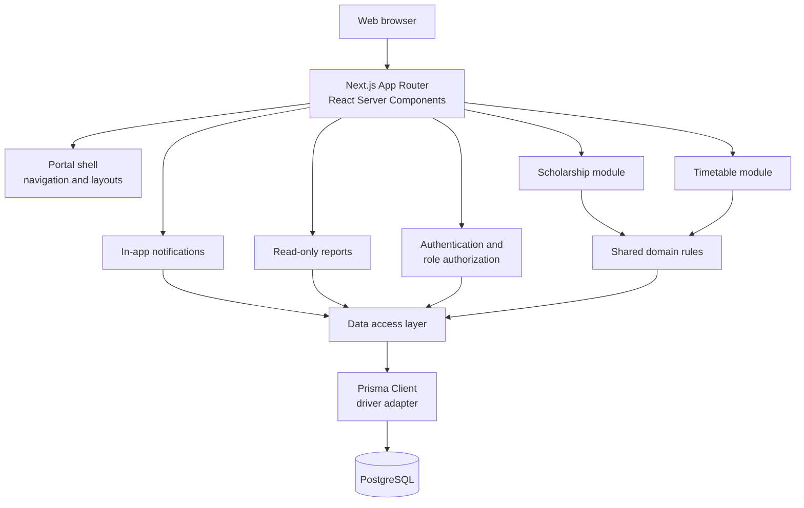

# Architecture

This document describes the structure of the University Scholarship and Academic Timetable Portal. It is a living document and is updated as decisions are made.

## 1. System overview



The application is one Next.js deployment and one PostgreSQL database. It is not a microservice system.

## 2. Application layers

| Layer              | Location                             | Responsibility                                                           |
| ------------------ | ------------------------------------ | ------------------------------------------------------------------------ |
| Routes and layouts | `app/`                               | URL structure, page composition, metadata, loading and error states      |
| Portal shell       | `components/portal/`                 | Sidebar, navigation, top bar, content frame, footer                      |
| UI components      | `components/ui/`                     | Reusable cards, buttons, badges, forms, tables, alerts, and empty states |
| Domain logic       | `lib/`                               | Conflict rules, room assignment, deadline state, authorization helpers   |
| Authentication     | `lib/auth/`                          | Password hashing, sessions, guards, roles, and user-management actions   |
| Data access        | `lib/db/`, `lib/<module>/queries.ts` | Shared Prisma client and module query functions                          |
| Database           | `prisma/`                            | Schema, migration history, and seed data                                 |
| Validation         | `lib/validation/`                    | Server-side Zod schemas for every mutation                               |

Route handlers, server actions, and pages stay thin: validate input, check authorization, call shared domain logic, call a data-access function, and return a result. Business rules must not be copied into multiple screens.

## 3. Runtime model

- **Next.js App Router** with React Server Components by default.
- Client components are introduced only for interaction that needs browser state, such as active navigation highlighting.
- All authentication and authorization decisions are enforced on the server.
- Input is validated on the server before it reaches the database.
- Database access is centralised through `lib/db/prisma.ts` and module query functions.
- The public landing page and the portal route group share the root layout but render different shells.

## 4. Route structure

```text
app/
├── layout.tsx                 Root document, fonts, metadata
├── page.tsx                   Public portal overview
├── error.tsx                  Root error boundary
├── globals.css                Tailwind theme, dark-mode variant, and base typography
├── api/health/route.ts        Database-aware deployment health check
├── login/
│   ├── page.tsx               Public login page
│   └── login-form.tsx         Client form using useActionState
└── (portal)/
    ├── layout.tsx             Authenticated shell; requires a session
    ├── error.tsx              In-shell error boundary
    ├── loading.tsx            Route-level loading skeleton
    ├── dashboard/
    │   ├── page.tsx           Live role-specific summary
    │   └── loading.tsx        Dashboard loading skeleton
    ├── notifications/
    │   ├── page.tsx           Per-user notification centre and read actions
    │   └── loading.tsx        Notification loading skeleton
    ├── scholarships/
    │   ├── page.tsx           Student catalogue or staff management
    │   ├── loading.tsx        Scholarship loading skeleton
    │   ├── new/page.tsx       Staff-only create form
    │   └── [id]/
    │       ├── page.tsx       Detail, bookmark, and staff controls
    │       ├── edit/page.tsx  Staff-only edit form
    │       └── not-found.tsx  Friendly unavailable-record state
    ├── timetable/
    │   ├── page.tsx           Role-aware schedule: staff editor, coordinator read-only, student batch view
    │   ├── loading.tsx        Timetable loading skeleton
    │   ├── new/page.tsx       Staff-only create form
    │   ├── [id]/
    │   │   ├── edit/page.tsx  Staff-only edit form
    │   │   └── not-found.tsx  Friendly unavailable-class state
    │   ├── courses/page.tsx   Staff CRUD, coordinator read-only
    │   ├── teachers/page.tsx  Staff CRUD, coordinator read-only
    │   └── batches/page.tsx   Staff CRUD, coordinator read-only
    ├── rooms/
    │   ├── page.tsx           Room CRUD and today's usage
    │   └── loading.tsx        Room loading skeleton
    ├── reports/
    │   ├── page.tsx           Staff/coordinator live report summaries
    │   └── loading.tsx        Report loading skeleton
    └── users/
        ├── page.tsx           Coordinator user management
        └── loading.tsx        User loading skeleton
```

The `(portal)` folder is a route group, so it does not appear in URLs. The layout requires a valid session, and each page performs its own guard: all roles for the dashboard, scholarships, and timetable; staff or coordinator for scholarship writes, rooms, and reports; coordinator only for people. The layout check alone is not treated as sufficient protection for nested segments.

## 5. Data layer

### 5.1 ORM decision

Prisma 7.10.1 is used with the `prisma-client` generator and the `@prisma/adapter-pg` driver adapter. Drizzle was the alternative, but Prisma was chosen because it provides:

- a readable schema that maps directly to the ER model;
- generated TypeScript types for every model and relation;
- a migration history that is easy to explain;
- a simple path from schema design to PostgreSQL queries.

The decision is recorded here and must remain consistent across phases.

### 5.2 Shared client

`lib/db/prisma.ts` creates one `PrismaClient` with a PostgreSQL adapter and reuses it through `globalThis` during development. Reusing the client avoids exhausting connections during hot reloads.

The generated client is written to `lib/generated/prisma/` and ignored by Git. It is recreated by:

- `npm install` through `postinstall`;
- `npm run db:generate`;
- `npm run build` through `prebuild`.

### 5.3 Connection configuration

`prisma.config.ts` loads `.env.local` first and then `.env`, so the Prisma CLI and Next.js read the same local connection string. The schema file deliberately contains no credentials. A non-secret local fallback keeps schema validation and client generation usable before a database is configured.

### 5.4 Query organisation

- Schema and migrations live in `prisma/`.
- The shared client lives in `lib/db/prisma.ts`.
- Module reads live beside their module, for example `lib/scholarships/queries.ts`; module writes live in `lib/scholarships/actions.ts`.
- Cross-module read models live in `lib/dashboard/queries.ts`, `lib/reports/queries.ts`, and `lib/notifications/queries.ts`. They combine module data without duplicating business rules.
- Framework-free business rules live in `lib/scholarships/rules.ts` and `lib/timetable/rules.ts` so pages, actions, and the seed script share one definition.
- Shared calendar helpers live in `lib/time/portal.ts`; scholarship rules re-export them so existing imports keep one source of truth.
- Pages do not build ad-hoc queries inline when the same query is needed elsewhere.
- Mutations use a transaction when they change more than one related record.

## 6. Modules

### 6.1 Scholarship module

Implemented in Phase 3:

- Student catalogue with keyword search, category filter, deadline filter, and a saved-only view.
- Detail page with description, eligibility, benefits, required documents, deadline, and the official application link.
- Per-student bookmark save and remove. The `(userId, scholarshipId)` pair is unique.
- Staff and coordinator management: create drafts, edit, publish, archive, mark expired, and delete.
- Draft, active, closing-soon, expired, and archived states derived from stored status plus the calendar deadline.
- Expired records stay readable to students who reach them directly, but cannot be newly saved.
- Publication creates notification rows for active students; explicit expiry notifies students who saved the record. These rows are shown in the notification centre.

Business rules live in `lib/scholarships/rules.ts`. The portal treats `Asia/Karachi` as its calendar time zone and compares `@db.Date` deadlines at UTC midnight, which keeps "today" deterministic for every request and for the seed script.

A stored `PUBLISHED` record whose deadline has passed is treated as expired for every decision without rewriting the stored status. Staff can also set `EXPIRED` explicitly. Only `PUBLISHED` records with a deadline of today or later are active and newly saveable.

Reads live in `lib/scholarships/queries.ts`, writes in `lib/scholarships/actions.ts`, and input validation in `lib/validation/scholarship.ts`. The module does not contain timetable rules.

### 6.2 Timetable module

Implemented in Phase 4:

- Staff maintain courses, teachers, batches/sections, and rooms per department. Coordinators see the same reference data read-only.
- The timetable page is a table-first schedule with batch, teacher, day, today, and free-text filters. The search matches course code, course title, teacher name, and room number. Staff can add, edit, and delete rows; coordinators see the same schedule without mutation controls.
- Students see only their linked batch timetable, with today's classes and the next class. A student without a batch receives an explicit explanation.
- Every save re-checks teacher, batch, and room conflicts on the server using one shared interval rule.
- Automatic room assignment is deterministic: department rooms are ordered by `roomNumber ASC, id ASC`, overlapping rooms are removed, and the first remaining room is assigned. If none remain, the action returns an explicit no-room result and writes nothing.
- Deleting reference data is blocked while a timetable row uses it.
- Room records show today's usage for each department room.

The interval rule is:

```text
existingStart < newEnd
AND
existingEnd > newStart
```

Class times are stored as minutes from midnight, so the comparison is deterministic and easy to test. Reads live in `lib/timetable/queries.ts`, mutations in `lib/timetable/actions.ts`, rules in `lib/timetable/rules.ts`, and validation in `lib/validation/timetable.ts`.

Timetable create, update, and delete actions notify the active students in the affected batches through `lib/notifications/timetable.ts`. An update notifies both the previous and the new batch when the batch changes. Notification insertion is best-effort: a failure is logged and never rolls back or blocks the saved schedule change.

### 6.3 Authentication and authorization

Implemented in Phase 2:

- Login with email and password; logout from the portal shell.
- bcrypt password hashing at cost 12.
- Database-backed sessions: a random token in an HTTP-only cookie and an HMAC-SHA256 token hash in the `Session` table.
- Seven-day absolute session expiry.
- Route protection through the portal layout and page-level guards.
- Server-side role checks in every restricted page and server action.
- Role-aware navigation and role-specific dashboards.
- Coordinator user management: account creation, role assignment, activation, and deactivation.
- Immediate session revocation on logout or deactivation.

Authorization helpers live in `lib/auth/dal.ts` and are reused rather than reimplemented per page. Hiding a navigation item is only a usability measure; the server guard remains the security boundary.

The session strategy is intentionally simple enough to explain clearly:

```text
token = random 256-bit value
cookie = token
database.tokenHash = HMAC-SHA256(token, SESSION_SECRET)
request -> hash cookie token -> look up session -> check expiry and isActive
```

### 6.4 Notifications and reports

Notifications are in-system records only. Reports are small read-only summaries. Neither module requires an external service, SMS, WhatsApp, email, or push infrastructure.

Implemented in Phase 5:

- `/notifications` lists only rows owned by the signed-in account. Users can switch between all and unread views, mark one message read, or mark every unread message read. The portal navigation shows the unread count.
- Read actions use the signed-in session and `updateMany` with a `userId` constraint, so a crafted notification ID cannot change another account's row.
- Scholarship publication and expiry rows created in Phase 3 now appear in the centre. The seed adds deadline, room-assignment, and timetable examples for demonstration.
- Timetable create, update, and delete actions create `TIMETABLE_CHANGED` rows for active students in the affected batches. The message names the course, day, time, and assigned room.
- A notification failure is logged but never rolls back the scholarship or timetable change that caused it.
- `/reports` is restricted to staff and coordinators with a department. It shows active scholarships, scholarships closing within 14 days, timetable by batch, timetable by teacher, room usage for the current day, and teacher/batch/room conflicts.
- The dashboard reads live data through `lib/dashboard/queries.ts`. Students receive scholarship, deadline, saved-record, today's-class, and next-class data. Staff and coordinators receive scholarship, timetable, room, and conflict data; coordinators also see the active-account count.
- Report queries live in `lib/reports/queries.ts`. They reuse timetable queries and the shared conflict rule rather than recreating either.
- Reports are deliberately basic. They do not provide charts, exports, scheduled delivery, or historical analytics.

## 7. Roles

| Role        | Primary access                                                                  |
| ----------- | ------------------------------------------------------------------------------- |
| Student     | Browse and save scholarships; view the timetable for their batch                |
| Staff       | Maintain scholarships, academic reference data, timetable entries, and requests |
| Coordinator | Manage users and roles, department records, and view oversight reports          |

The detailed role matrix is in [requirements.md](requirements.md).

## 8. Configuration and security

Secrets are supplied through `.env.local` (ignored by Git) and documented in `.env.example`.

| Variable         | Purpose                                                       |
| ---------------- | ------------------------------------------------------------- |
| `DATABASE_URL`   | PostgreSQL connection string used by Prisma and the app       |
| `SESSION_SECRET` | HMAC pepper for session tokens; at least 32 characters        |
| `SEED_PASSWORD`  | Password assigned to local demo accounts by `npm run db:seed` |

Rules:

- Browser-exposed values must use the `NEXT_PUBLIC_` prefix and must never contain secrets.
- Passwords are never stored or logged in plain text.
- Session tokens are never logged or stored unhashed.
- Server validation is required even when the UI already validates the same field.
- Database errors are logged internally and replaced with safe user-facing messages.
- Generated files and local reports are not committed.

## 9. Quality gates

A phase is complete only when:

1. The implementation is finished.
2. `npm run lint` passes.
3. `npm run typecheck` passes.
4. `npm run db:validate` passes.
5. `npm run build` passes.
6. Tests pass once a test suite exists.
7. The affected flow is verified manually.
8. Documentation and the required report are updated.

## 10. Testing

The test suite uses Vitest. Tests are split into two groups:

| Group       | Location             | Scope                                                                                 |
| ----------- | -------------------- | ------------------------------------------------------------------------------------- |
| Unit        | `tests/unit/`        | Time helpers, interval overlap, conflict pairs, room selection, scholarship state, authorization, and validation |
| Integration | `tests/integration/` | Real PostgreSQL queries for conflict detection and free-room assignment                |

Unit tests do not need a database. Integration tests read `DATABASE_URL` from `.env.local` and are skipped when it is absent. Integration tests create an isolated department and remove every row they created after the run.

Commands:

```bash
npm test                 # every test
npm run test:unit        # unit tests only
npm run test:integration # database-backed tests
```

`npm run check` now runs linting, type checking, Prisma validation, and the full test suite. `npm run build` remains a separate production-build gate.

The tests verify deterministic rules rather than UI snapshots. The main rules under test are:

- end-of-interval boundaries are exclusive, so adjacent classes do not conflict;
- teacher, batch, and room conflicts are reported separately;
- the edited timetable row is excluded from its own conflict check;
- the first free room is chosen in room-number order, or the result is null;
- published scholarships become closing-soon or expired from the calendar deadline without rewriting stored status;
- anonymous and wrong-role guards redirect before protected data is read;
- return paths cannot become open redirects;
- every server-side Zod schema rejects malformed input.

## 11. Deployment

Deployment uses a multi-stage Dockerfile and Docker Compose:

- PostgreSQL 16 with a persistent volume;
- a one-shot migration service running `prisma migrate deploy`;
- a standalone Next.js runtime image running as a non-root user;
- an optional seed service under the `tools` Compose profile;
- a database-aware `/api/health` endpoint for container health checks.

Security headers are configured in `next.config.ts` and `X-Powered-By` is disabled. Full operating instructions, environment variables, backup commands, and a verification checklist are in [deployment.md](deployment.md).

## 12. Deferred decisions

The following items are intentionally out of scope:

- PDF export and scheduled report delivery.
- Email, SMS, or push notification delivery.
- Multi-department tenancy beyond the seeded department model.
- Historical timetable versioning and analytics.

## 13. Constraints

The architecture must remain explainable:

- One application, not a set of microservices.
- Deterministic business rules, not optimisation or machine learning.
- No external messaging or scraping services required for the core system.
- Every important feature must be testable without optional integrations.
- Every important rule must be enforceable on the server.
