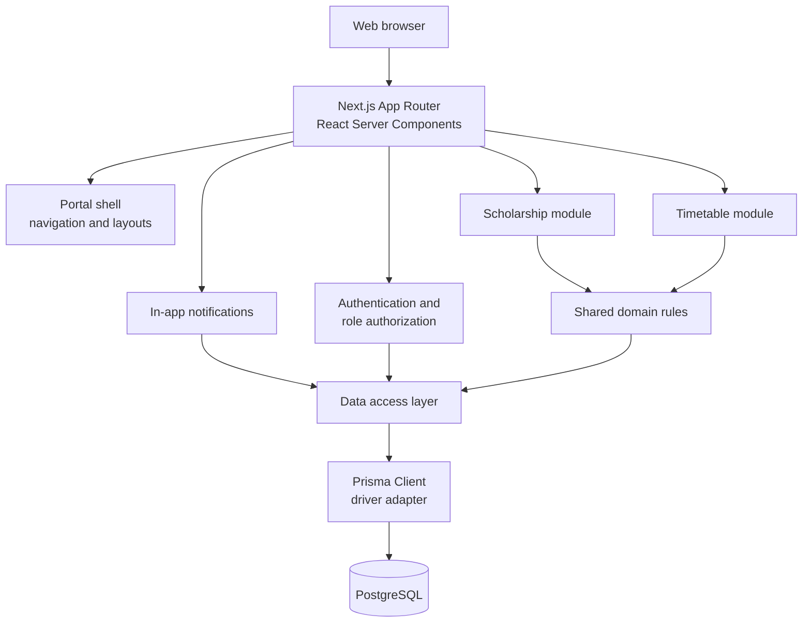

# Architecture

This document describes the structure of the University Scholarship and Academic Timetable Portal. It is a living document and is updated as decisions are made.

## 1. System overview



The application is one Next.js deployment and one PostgreSQL database. It is not a microservice system.

## 2. Application layers

| Layer              | Location                         | Responsibility                                                           |
| ------------------ | -------------------------------- | ------------------------------------------------------------------------ |
| Routes and layouts | `app/`                           | URL structure, page composition, metadata, loading and error states      |
| Portal shell       | `components/portal/`             | Sidebar, navigation, top bar, content frame, footer                      |
| UI components      | `components/ui/`                 | Reusable cards, buttons, badges, forms, tables, alerts, and empty states |
| Domain logic       | `lib/`                           | Conflict rules, room assignment, deadline state, authorization helpers   |
| Data access        | `lib/db/`                        | Shared Prisma client and, later, module-specific query functions         |
| Database           | `prisma/`                        | Schema, migration history, and seed data                                 |
| Validation         | `lib/validation/` (from Phase 2) | Server-side schemas for every mutation                                   |

Route handlers, server actions, and pages stay thin: validate input, check authorization, call shared domain logic, call a data-access function, and return a result. Business rules must not be copied into multiple screens.

## 3. Runtime model

- **Next.js App Router** with React Server Components by default.
- Client components are introduced only for interaction that needs browser state, such as active navigation highlighting.
- All authentication and authorization decisions are enforced on the server.
- Input is validated on the server before it reaches the database.
- Database access is centralised through `lib/db/prisma.ts` and module query functions.
- The public landing page and the portal route group share the root layout but render different shells.

## 4. Route structure

```text
app/
├── layout.tsx                 Root document, fonts, metadata
├── page.tsx                   Public portal overview
├── globals.css                Tailwind theme and base typography
└── (portal)/
    ├── layout.tsx             Shared portal shell
    ├── loading.tsx            Route-level loading skeleton
    ├── dashboard/page.tsx
    ├── scholarships/page.tsx
    ├── timetable/page.tsx
    ├── rooms/page.tsx
    ├── reports/page.tsx
    └── users/page.tsx
```

The `(portal)` folder is a route group, so it does not appear in URLs. Phase 2 adds protected access and role-aware navigation. Phase 3–5 replace the current placeholder content with real data and actions.

## 5. Data layer

### 5.1 ORM decision

Prisma 7.10.1 is used with the `prisma-client` generator and the `@prisma/adapter-pg` driver adapter. Drizzle was the alternative, but Prisma was chosen because it provides:

- a readable schema that maps directly to the ER model;
- generated TypeScript types for every model and relation;
- a migration history that is easy to explain in a viva;
- a simple path from schema design to PostgreSQL queries.

The decision is recorded here and must remain consistent across phases.

### 5.2 Shared client

`lib/db/prisma.ts` creates one `PrismaClient` with a PostgreSQL adapter and reuses it through `globalThis` during development. Reusing the client avoids exhausting connections during hot reloads.

The generated client is written to `lib/generated/prisma/` and ignored by Git. It is recreated by:

- `npm install` through `postinstall`;
- `npm run db:generate`;
- `npm run build` through `prebuild`.

### 5.3 Connection configuration

`prisma.config.ts` loads `.env.local` first and then `.env`, so the Prisma CLI and Next.js read the same local connection string. The schema file deliberately contains no credentials. A non-secret local fallback keeps schema validation and client generation usable before a database is configured.

### 5.4 Query organisation

- Schema and migrations live in `prisma/`.
- The shared client lives in `lib/db/prisma.ts`.
- Module query functions will live under `lib/db/` or a module folder when their first feature needs them.
- Pages do not build ad-hoc queries inline when the same query is needed elsewhere.
- Mutations use a transaction when they change more than one related record.

## 6. Modules

### 6.1 Scholarship module

Responsibilities:

- Maintain title, provider, category, description, eligibility, benefits, required documents, deadline, application URL, and status.
- Serve active opportunities with search and filters.
- Track bookmarks per student.
- Derive active and expiring-soon state from status and deadline.
- Keep archived and expired records available as reference for staff.

The module owns its validation and repository functions. It does not contain timetable rules.

### 6.2 Timetable module

Responsibilities:

- Maintain courses, teachers, batches/sections, rooms, and timetable entries.
- Reject teacher, batch, and room conflicts using one shared interval rule.
- Assign the first free department room when automatic assignment is requested.
- Provide batch, teacher, and today views.
- Return an explicit no-room result instead of inventing a room.

The interval rule is:

```text
existingStart < newEnd
AND
existingEnd > newStart
```

Class times are stored as minutes from midnight, so the comparison is deterministic and easy to test.

### 6.3 Authentication and authorization

Phase 2 adds:

- login and logout;
- password hashing;
- session cookies;
- route protection;
- server-side role checks;
- role-aware dashboards and navigation.

Authorization helpers will live close to protected operations and will be reused rather than reimplemented per page.

### 6.4 Notifications and reports

Notifications are in-system records only. Reports are small read-only summaries. Neither module requires an external service, SMS, WhatsApp, email, or push infrastructure.

## 7. Roles

| Role        | Primary access                                                                  |
| ----------- | ------------------------------------------------------------------------------- |
| Student     | Browse and save scholarships; view the timetable for their batch                |
| Staff       | Maintain scholarships, academic reference data, timetable entries, and requests |
| Coordinator | Manage users and roles, department records, and view oversight reports          |

The detailed role matrix is in [requirements.md](requirements.md).

## 8. Configuration and security

Secrets are supplied through `.env.local` (ignored by Git) and documented in `.env.example`.

| Variable         | Purpose                                                 |
| ---------------- | ------------------------------------------------------- |
| `DATABASE_URL`   | PostgreSQL connection string used by Prisma and the app |
| `SESSION_SECRET` | Signing secret for session cookies                      |

Rules:

- Browser-exposed values must use the `NEXT_PUBLIC_` prefix and must never contain secrets.
- Passwords are never stored or logged in plain text.
- Server validation is required even when the UI already validates the same field.
- Database errors are logged internally and replaced with safe user-facing messages.
- Generated files and local reports are not committed.

## 9. Quality gates

A phase is complete only when:

1. The implementation is finished.
2. `npm run lint` passes.
3. `npm run typecheck` passes.
4. `npm run db:validate` passes.
5. `npm run build` passes.
6. Tests pass once a test suite exists.
7. The affected flow is verified manually.
8. Documentation and the required report are updated.

## 10. Deferred decisions

The following decisions are intentionally left to the phase that needs them:

- Session storage representation and password hashing library — Phase 2.
- Testing framework and end-to-end tooling — Phase 6.
- Deployment target and container setup — Phase 6/7.
- Optional PDF export — Phase 5/6, only if it does not destabilise the core system.

## 11. Constraints

The architecture must remain explainable in a viva:

- One application, not a set of microservices.
- Deterministic business rules, not optimisation or machine learning.
- No external messaging or scraping services required for the core system.
- Every important feature must be testable without optional integrations.
- Every important rule must be enforceable on the server.
