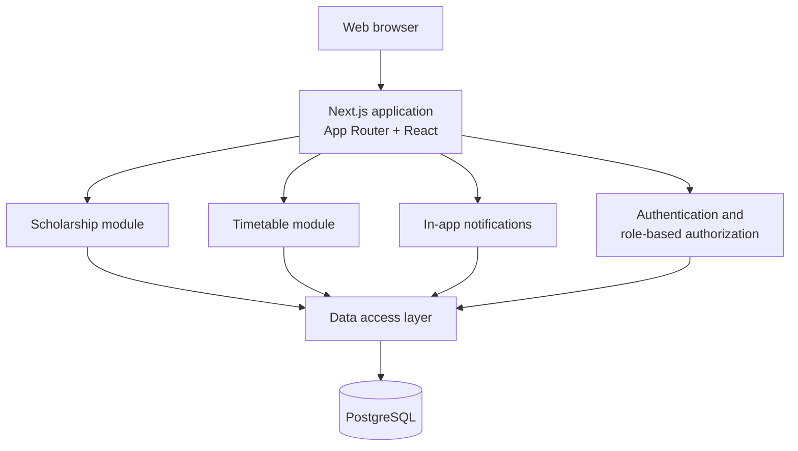

# Architecture

This document describes the high-level structure of the University Scholarship and Academic Timetable Portal. It is a living document and will be refined as each phase is implemented.

## System overview



## Application layers

| Layer              | Location            | Responsibility                                                            |
| ------------------ | ------------------- | ------------------------------------------------------------------------- |
| Routes and layouts | `app/`              | URL structure, page composition, loading and error states                 |
| UI components      | `components/`       | Reusable presentation and form components                                 |
| Domain logic       | `lib/`              | Conflict rules, room assignment, deadline handling, authorization helpers |
| Data access        | `lib/db` (planned)  | Centralised database queries and transactions                             |
| Database           | `prisma/` (planned) | Schema, migrations, and seed data                                         |

Route handlers and server actions stay thin: they validate input, check authorization, call domain logic, and return a result. Business rules live in small, testable functions so the same rule cannot drift between screens.

## Runtime model

- **Next.js App Router** with React Server Components by default.
- Client components are used only where interactivity requires them.
- All authorization decisions are enforced on the server. Hiding a button in the UI is a usability measure, never a security control.
- Input is validated on the server with Zod before it reaches the database.
- Database access is centralised; pages do not construct their own queries in an ad hoc way.

## Modules

### Scholarship module

Responsibilities:

- Maintain scholarship records (title, provider, description, eligibility, benefits, required documents, deadline, application link, status).
- Serve active opportunities to students with search and filtering.
- Track saved scholarships per student.
- Derive deadline state from the stored deadline and status.

### Timetable module

Responsibilities:

- Maintain courses, teachers, batches/sections, rooms, and timetable entries.
- Reject overlapping assignments for the same teacher, batch, or room.
- Assign the first suitable free room when automatic assignment is requested.
- Provide batch, teacher, and daily views.

The conflict rule uses interval overlap:

```text
existingStart < newEnd AND existingEnd > newStart
```

Automatic room assignment is deterministic: load the department's rooms in a stable order, remove rooms occupied during the requested interval, and select the first remaining room. If none remains, the user receives an explicit "no room available" result.

## Roles

| Role             | Primary access                                                             |
| ---------------- | -------------------------------------------------------------------------- |
| Student          | Browse and save scholarships; view the timetable for their batch/section   |
| Authorised staff | Maintain scholarships and timetable records                                |
| Coordinator      | Manage users and department records; view scholarship and timetable status |

Authorization is checked server-side for every protected read and write.

## Configuration

Secrets are supplied through `.env.local` (ignored by Git) and documented in `.env.example`. The current variables are:

- `DATABASE_URL` — PostgreSQL connection string.
- `SESSION_SECRET` — signing secret for session cookies.

Browser-exposed values must use the `NEXT_PUBLIC_` prefix and must never contain secrets.

## Deferred decisions

The following decisions are intentionally left to the phase that needs them:

- ORM selection (Prisma or Drizzle) and migration workflow — Phase 1.
- Session storage strategy and password hashing library — Phase 2.
- Testing framework and end-to-end tooling — Phase 6.
- Deployment target and container setup — Phase 6/7.

## Constraints

The architecture must remain explainable in a viva:

- One application, not a set of microservices.
- Deterministic business rules, not optimisation or machine learning.
- No external messaging or scraping services required for the core system.
- Every important feature must be testable without optional integrations.
