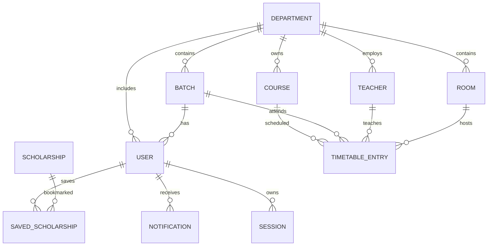

# Database Design

> **Status:** finalised in Phase 1. The Prisma schema is the executable source of truth; this document explains the model, constraints, and rules in plain language.

## 1. Technology

| Area             | Decision                                                          |
| ---------------- | ----------------------------------------------------------------- |
| Database         | PostgreSQL 15 or newer                                            |
| ORM              | Prisma 7.10.1                                                     |
| Driver adapter   | `@prisma/adapter-pg` with `pg`                                    |
| Schema           | `prisma/schema.prisma`                                            |
| Config           | `prisma.config.ts`                                                |
| Migrations       | `prisma/migrations/`                                              |
| Generated client | `lib/generated/prisma/` (ignored by Git, recreated by generation) |
| Shared client    | `lib/db/prisma.ts`                                                |

The schema uses the `prisma-client` generator. The generated TypeScript client must be produced with `npm run db:generate`; `npm install` and `npm run build` also regenerate it.

## 2. Conventions

- **Primary keys:** `cuid()` strings, stable in URLs and foreign keys.
- **Timestamps:** `createdAt` defaults to now; mutable records also have `updatedAt`.
- **Calendar dates:** scholarship deadlines use PostgreSQL `DATE`.
- **Class times:** stored as `SMALLINT` minutes from midnight (for example, `540` is 09:00). This makes interval comparison a simple numeric operation and avoids time-zone conversion.
- **End-exclusive intervals:** a class from 09:00 to 10:00 is stored as `startMinute = 540`, `endMinute = 600`. The next class may start at 600.
- **Enums:** role, scholarship status, day of week, and notification type are database enums.
- **Deletion:** restrictive by default for academic reference data; cascading only for owned session, bookmark, and notification rows.

## 3. Entity relationship model



`User.batchId` and `User.departmentId` are optional. A student is expected to have a batch; a staff or coordinator account may have a department. The relation is optional at the database level so an account can be created before assignment.

## 4. Enumerations

| Enum                | Values                                                                                                                             |
| ------------------- | ---------------------------------------------------------------------------------------------------------------------------------- |
| `Role`              | `STUDENT`, `STAFF`, `COORDINATOR`                                                                                                  |
| `ScholarshipStatus` | `DRAFT`, `PUBLISHED`, `ARCHIVED`, `EXPIRED`                                                                                        |
| `DayOfWeek`         | `MONDAY` through `SUNDAY`                                                                                                          |
| `NotificationType`  | `SCHOLARSHIP_PUBLISHED`, `SCHOLARSHIP_DEADLINE`, `SCHOLARSHIP_EXPIRED`, `TIMETABLE_CHANGED`, `ROOM_ASSIGNED`, `TIMETABLE_CONFLICT` |

## 5. Tables

### 5.1 `User`

| Column         | Type           | Null | Rules                                                  |
| -------------- | -------------- | ---- | ------------------------------------------------------ |
| `id`           | `TEXT`         | No   | Primary key, `cuid()`                                  |
| `name`         | `TEXT`         | No   | Display name                                           |
| `email`        | `TEXT`         | No   | Unique; compared case-insensitively by the application |
| `passwordHash` | `TEXT`         | No   | One-way hash only                                      |
| `role`         | `Role`         | No   | Defaults to `STUDENT`                                  |
| `isActive`     | `BOOLEAN`      | No   | Defaults to `true`                                     |
| `batchId`      | `TEXT`         | Yes  | FK to `Batch`; `ON DELETE SET NULL`                    |
| `departmentId` | `TEXT`         | Yes  | FK to `Department`; `ON DELETE SET NULL`               |
| `createdAt`    | `TIMESTAMP(3)` | No   | Defaults to now                                        |
| `updatedAt`    | `TIMESTAMP(3)` | No   | Updated automatically by Prisma                        |

Indexes: `role`, `batchId`, `departmentId`; unique email.

### 5.2 `Scholarship`

| Column              | Type                | Null | Rules                              |
| ------------------- | ------------------- | ---- | ---------------------------------- |
| `id`                | `TEXT`              | No   | Primary key                        |
| `title`             | `TEXT`              | No   | Required                           |
| `provider`          | `TEXT`              | No   | Required                           |
| `category`          | `TEXT`              | Yes  | Optional filter value              |
| `description`       | `TEXT`              | No   | Full description                   |
| `eligibility`       | `TEXT`              | No   | Eligibility text                   |
| `benefits`          | `TEXT`              | No   | Benefits/amount where provided     |
| `requiredDocuments` | `TEXT`              | No   | Newline-separated or prose list    |
| `deadline`          | `DATE`              | No   | Inclusive calendar deadline        |
| `applicationUrl`    | `TEXT`              | No   | Official external application link |
| `status`            | `ScholarshipStatus` | No   | Defaults to `DRAFT`                |
| `createdAt`         | `TIMESTAMP(3)`      | No   | Defaults to now                    |
| `updatedAt`         | `TIMESTAMP(3)`      | No   | Updated automatically              |

Indexes: `(status, deadline)` for active listings; `category` for filters.

### 5.3 `SavedScholarship`

| Column          | Type           | Null | Rules                                    |
| --------------- | -------------- | ---- | ---------------------------------------- |
| `userId`        | `TEXT`         | No   | FK to `User`, `ON DELETE CASCADE`        |
| `scholarshipId` | `TEXT`         | No   | FK to `Scholarship`, `ON DELETE CASCADE` |
| `savedAt`       | `TIMESTAMP(3)` | No   | Defaults to now                          |

Primary key: `(userId, scholarshipId)`, which prevents duplicate bookmarks. Additional index on `scholarshipId` supports reverse lookups.

### 5.4 `Notification`

| Column      | Type               | Null | Rules                             |
| ----------- | ------------------ | ---- | --------------------------------- |
| `id`        | `TEXT`             | No   | Primary key                       |
| `userId`    | `TEXT`             | No   | FK to `User`, `ON DELETE CASCADE` |
| `type`      | `NotificationType` | No   | Required                          |
| `title`     | `TEXT`             | No   | Short summary                     |
| `message`   | `TEXT`             | No   | Full message                      |
| `isRead`    | `BOOLEAN`          | No   | Defaults to `false`               |
| `readAt`    | `TIMESTAMP(3)`     | Yes  | Set when read                     |
| `createdAt` | `TIMESTAMP(3)`     | No   | Defaults to now                   |

Index: `(userId, isRead, createdAt)` for the unread inbox.

### 5.5 `Department`

| Column      | Type           | Null | Rules                 |
| ----------- | -------------- | ---- | --------------------- |
| `id`        | `TEXT`         | No   | Primary key           |
| `name`      | `TEXT`         | No   | Unique                |
| `code`      | `TEXT`         | No   | Unique                |
| `createdAt` | `TIMESTAMP(3)` | No   | Defaults to now       |
| `updatedAt` | `TIMESTAMP(3)` | No   | Updated automatically |

### 5.6 `Course`

| Column         | Type           | Null | Rules                                    |
| -------------- | -------------- | ---- | ---------------------------------------- |
| `id`           | `TEXT`         | No   | Primary key                              |
| `code`         | `TEXT`         | No   | Unique within its department             |
| `title`        | `TEXT`         | No   | Course title                             |
| `departmentId` | `TEXT`         | No   | FK to `Department`, `ON DELETE RESTRICT` |
| `createdAt`    | `TIMESTAMP(3)` | No   | Defaults to now                          |
| `updatedAt`    | `TIMESTAMP(3)` | No   | Updated automatically                    |

Unique: `(departmentId, code)`.

### 5.7 `Teacher`

| Column         | Type           | Null | Rules                                    |
| -------------- | -------------- | ---- | ---------------------------------------- |
| `id`           | `TEXT`         | No   | Primary key                              |
| `name`         | `TEXT`         | No   | Display name                             |
| `email`        | `TEXT`         | Yes  | Unique within department when present    |
| `departmentId` | `TEXT`         | No   | FK to `Department`, `ON DELETE RESTRICT` |
| `createdAt`    | `TIMESTAMP(3)` | No   | Defaults to now                          |
| `updatedAt`    | `TIMESTAMP(3)` | No   | Updated automatically                    |

Unique: `(departmentId, email)`. PostgreSQL permits multiple `NULL` values, so teachers without email do not collide.

### 5.8 `Batch`

| Column         | Type           | Null | Rules                                    |
| -------------- | -------------- | ---- | ---------------------------------------- |
| `id`           | `TEXT`         | No   | Primary key                              |
| `name`         | `TEXT`         | No   | Programme/cohort label                   |
| `section`      | `TEXT`         | No   | Section label                            |
| `departmentId` | `TEXT`         | No   | FK to `Department`, `ON DELETE RESTRICT` |
| `createdAt`    | `TIMESTAMP(3)` | No   | Defaults to now                          |
| `updatedAt`    | `TIMESTAMP(3)` | No   | Updated automatically                    |

Unique: `(departmentId, name, section)`.

### 5.9 `Room`

| Column         | Type           | Null | Rules                                    |
| -------------- | -------------- | ---- | ---------------------------------------- |
| `id`           | `TEXT`         | No   | Primary key                              |
| `roomNumber`   | `TEXT`         | No   | Unique within its department             |
| `building`     | `TEXT`         | Yes  | Optional building label                  |
| `departmentId` | `TEXT`         | No   | FK to `Department`, `ON DELETE RESTRICT` |
| `createdAt`    | `TIMESTAMP(3)` | No   | Defaults to now                          |
| `updatedAt`    | `TIMESTAMP(3)` | No   | Updated automatically                    |

Unique: `(departmentId, roomNumber)`. Deterministic assignment order is `roomNumber ASC, id ASC`.

### 5.10 `TimetableEntry`

| Column        | Type           | Null | Rules                                       |
| ------------- | -------------- | ---- | ------------------------------------------- |
| `id`          | `TEXT`         | No   | Primary key                                 |
| `courseId`    | `TEXT`         | No   | FK to `Course`, `ON DELETE RESTRICT`        |
| `batchId`     | `TEXT`         | No   | FK to `Batch`, `ON DELETE RESTRICT`         |
| `teacherId`   | `TEXT`         | No   | FK to `Teacher`, `ON DELETE RESTRICT`       |
| `roomId`      | `TEXT`         | No   | FK to `Room`, `ON DELETE RESTRICT`          |
| `dayOfWeek`   | `DayOfWeek`    | No   | Recurring weekday                           |
| `startMinute` | `SMALLINT`     | No   | Minutes from midnight, `0–1439`             |
| `endMinute`   | `SMALLINT`     | No   | Exclusive end, `1–1440`, greater than start |
| `createdAt`   | `TIMESTAMP(3)` | No   | Defaults to now                             |
| `updatedAt`   | `TIMESTAMP(3)` | No   | Updated automatically                       |

The initial migration also adds database check constraints for the minute range and `startMinute < endMinute`.

Indexes:

- `(dayOfWeek, startMinute, endMinute)` for daily queries.
- `(teacherId, dayOfWeek, startMinute, endMinute)` for teacher conflicts.
- `(batchId, dayOfWeek, startMinute, endMinute)` for batch conflicts.
- `(roomId, dayOfWeek, startMinute, endMinute)` for room conflicts and availability.

### 5.11 `Session`

| Column      | Type           | Null | Rules                                    |
| ----------- | -------------- | ---- | ---------------------------------------- |
| `id`        | `TEXT`         | No   | Primary key                              |
| `tokenHash` | `TEXT`         | No   | Unique HMAC-SHA256 hash of the raw token |
| `userId`    | `TEXT`         | No   | FK to `User`, `ON DELETE CASCADE`        |
| `expiresAt` | `TIMESTAMP(3)` | No   | Absolute expiry; seven days after login  |
| `createdAt` | `TIMESTAMP(3)` | No   | Defaults to now                          |

Indexes: unique `tokenHash`; `userId` for revoking all sessions of one user; `expiresAt` for future cleanup jobs.

The raw session token exists only in the browser's HTTP-only cookie. The database never stores it, so a database read alone cannot be replayed as a login.

## 6. Scholarship rules

### 6.1 Effective state

A scholarship is **active** when:

```text
status = PUBLISHED
AND deadline >= today
```

`deadline` is a calendar date and is inclusive through the end of that date. A published record whose date has passed is excluded from active results even if its stored status is still `PUBLISHED`. Staff can also set `EXPIRED` explicitly.

### 6.2 Visibility

| Status      | Student default listing   | Student direct detail | Staff management |
| ----------- | ------------------------- | --------------------- | ---------------- |
| `DRAFT`     | No                        | No                    | Yes              |
| `PUBLISHED` | Yes, if not past deadline | Yes                   | Yes              |
| `ARCHIVED`  | No                        | No                    | Yes              |
| `EXPIRED`   | No                        | Read-only reference   | Yes              |

### 6.3 Deadlines soon

A scholarship is “expiring soon” when it is active and its deadline is within the next 14 calendar days, inclusive of today. The value is derived, not stored.

### 6.4 Bookmarks

- A student has at most one bookmark per scholarship.
- Only active scholarships can be newly saved.
- Removing a bookmark deletes only that pair.
- Deleting a scholarship cascades its bookmark rows.
- An expired saved scholarship remains visible in the student's saved list with an expired marker.

## 7. Timetable rules

### 7.1 Overlap test

Two entries conflict when all of the following are true:

1. They share the same `dayOfWeek`.
2. They share the same teacher, batch, or room, depending on the check.
3. `existing.startMinute < new.endMinute`.
4. `existing.endMinute > new.startMinute`.

The end minute is exclusive. On update, the current entry is excluded from the query.

### 7.2 Department consistency

- A course, teacher, batch, and room each belong to one department.
- All four selected references on an entry must belong to the same department.
- Automatic assignment uses the batch's department.
- A referenced reference-data row cannot be deleted while an entry uses it.

### 7.3 Automatic room assignment

Algorithm:

```text
rooms = department rooms ordered by roomNumber ASC, id ASC
freeRooms = rooms where no entry overlaps the selected day/interval
if freeRooms is empty:
    return NO_ROOM_AVAILABLE
return freeRooms[0]
```

“Suitable” means owned by the department and free at the requested interval. Capacity scoring, distance, and optimisation are out of scope. The same input and data state always produce the same room.

### 7.4 Time representation

The UI accepts `HH:mm` and converts it to minutes:

```text
minutes = hours * 60 + minutes
```

The server validates `0 <= startMinute < endMinute <= 1440`. This avoids comparing formatted strings and removes daylight-saving/time-zone ambiguity from a recurring weekly schedule.

## 8. Authorization boundaries

| Data/action                      | Student | Staff | Coordinator |
| -------------------------------- | ------- | ----- | ----------- |
| Read active scholarships         | Yes     | Yes   | Yes         |
| Save scholarships                | Yes     | No    | No          |
| Maintain scholarships            | No      | Yes   | No          |
| Maintain academic reference data | No      | Yes   | No          |
| Create timetable entries         | No      | Yes   | No          |
| Read own batch timetable         | Yes     | Yes   | Yes         |
| Manage users and roles           | No      | No    | Yes         |
| View operational reports         | No      | Yes   | Yes         |

Implementation phases must re-check these rules on the server. The role matrix is a specification, not a UI-only rule.

## 9. Migrations and seed data

- The initial migration is `prisma/migrations/20261106150000_init/migration.sql`.
- The Phase 2 session table is added by `prisma/migrations/20261106190000_add_sessions/migration.sql`.
- Phase 4 required no schema change: the timetable and room models, indexes, and check constraints were created in the initial migration.
- Apply migrations with `npm run db:migrate` when PostgreSQL is available.
- Every later schema change must be delivered as a committed migration.
- `prisma/seed.ts` creates one CSE department, the `BCS-7A` and `BCS-7B` batches, one coordinator, one staff account, one active student, and one inactive student. It also creates five courses, five teachers, six rooms, and 22 conflict-free timetable rows across Monday to Saturday. It is idempotent and uses `SEED_PASSWORD` from the environment.
- Seed data is local development data. It must not be inserted into production automatically.
- Production starts with only the coordinator account created through a documented bootstrap step.

## 10. Authentication storage

| Concern          | Decision                                                                   |
| ---------------- | -------------------------------------------------------------------------- |
| Password hashing | bcrypt, cost factor 12                                                     |
| Session token    | 256 random bits, encoded with base64url                                    |
| Token storage    | HMAC-SHA256 hash in `Session.tokenHash`; the raw token stays in the cookie |
| Cookie           | HTTP-only, SameSite=Lax, path `/`, seven-day expiry, Secure in production  |
| Logout           | Delete the matching `Session` row and clear the cookie                     |
| Deactivation     | Delete every `Session` row for the user; login is also refused             |
| Expiry           | Checked against `expiresAt` on every authenticated request                 |

`SESSION_SECRET` is the HMAC pepper. It is required at request time and must be at least 32 characters. It is never sent to the browser.

## 11. Deferred database decisions

- Audit/history tables are not required for the core scope.
- Full-text search indexes are not required; ordinary search can use PostgreSQL `ILIKE` for the expected data volume.
- PDF/export storage is not required.
