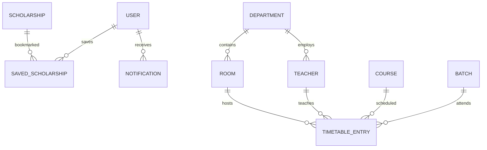

# Database Design

> **Status:** preliminary. The schema, field types, and constraints are finalised in Phase 1. This document defines the intended model so later work has a single reference point.

## Technology

- **Database:** PostgreSQL
- **ORM and migrations:** selected in Phase 1 (Prisma or Drizzle, then used consistently)
- **Identifiers:** stable primary keys suitable for URLs and foreign keys
- **Timestamps:** creation and update timestamps on mutable records

## Planned entities



### Core tables

| Entity             | Purpose                      | Key fields (preliminary)                                                                                                           |
| ------------------ | ---------------------------- | ---------------------------------------------------------------------------------------------------------------------------------- |
| `User`             | Portal account and role      | id, name, email, passwordHash, role, batchId?, createdAt, updatedAt                                                                |
| `Scholarship`      | Maintained opportunity       | id, title, provider, description, eligibility, benefits, requiredDocuments, deadline, applicationUrl, status, createdAt, updatedAt |
| `SavedScholarship` | Student bookmark             | userId, scholarshipId, createdAt (unique pair)                                                                                     |
| `Notification`     | In-app message               | id, userId, type, message, isRead, createdAt                                                                                       |
| `Department`       | Room and staff ownership     | id, name, code                                                                                                                     |
| `Course`           | Subject taught               | id, code, title, departmentId                                                                                                      |
| `Teacher`          | Teaching staff               | id, name, email, departmentId                                                                                                      |
| `Batch`            | Programme cohort and section | id, name, section, departmentId                                                                                                    |
| `Room`             | Physical teaching space      | id, roomNumber, building, capacity, departmentId                                                                                   |
| `TimetableEntry`   | Scheduled class              | id, courseId, batchId, teacherId, roomId, dayOfWeek, startTime, endTime, createdAt, updatedAt                                      |

Final field names and nullability may change once use cases are written. Any change must be recorded here and in the migration that implements it.

## Invariants

### Scholarship state

- A scholarship is **active** when its status is published and its deadline has not passed.
- Expired scholarships remain readable for reference but are excluded from default student listings.
- Deleting a scholarship must respect saved-bookmark references (cascade or explicit cleanup, decided in Phase 1).

### Timetable overlap

Two entries conflict when they share the same day and their intervals overlap:

```text
existingStart < newEnd AND existingEnd > newStart
```

Apply this check separately for:

- teacher;
- batch/section;
- room.

The check is enforced in one shared domain function and called before every create or update. Database constraints provide defence in depth where practical, but the application rule is the primary explanation.

### Automatic room assignment

- Consider only rooms belonging to the relevant department.
- Exclude rooms with an overlapping timetable entry.
- Order candidates deterministically (for example, by room number).
- Assign the first free room, or return an explicit "no room available" result.

## Indexing and performance

Indexes will be chosen from actual query patterns in Phase 1, with likely candidates:

- `TimetableEntry(dayOfWeek, startTime, endTime)` for overlap queries.
- `TimetableEntry(teacherId, dayOfWeek)`, `TimetableEntry(batchId, dayOfWeek)`, `TimetableEntry(roomId, dayOfWeek)`.
- `Scholarship(status, deadline)` for active listings.
- `SavedScholarship(userId)` and a unique `(userId, scholarshipId)` pair.

## Migrations and seed data

- Every schema change is delivered as a committed migration.
- Seed data is limited to development fixtures: roles, departments, sample rooms, sample courses, and sample scholarships.
- Production starts with only the coordinator account created through a documented bootstrap step.
