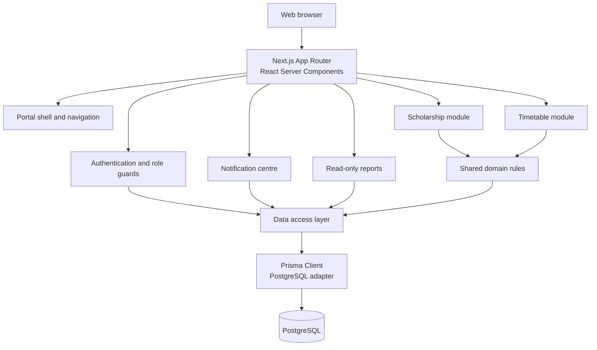
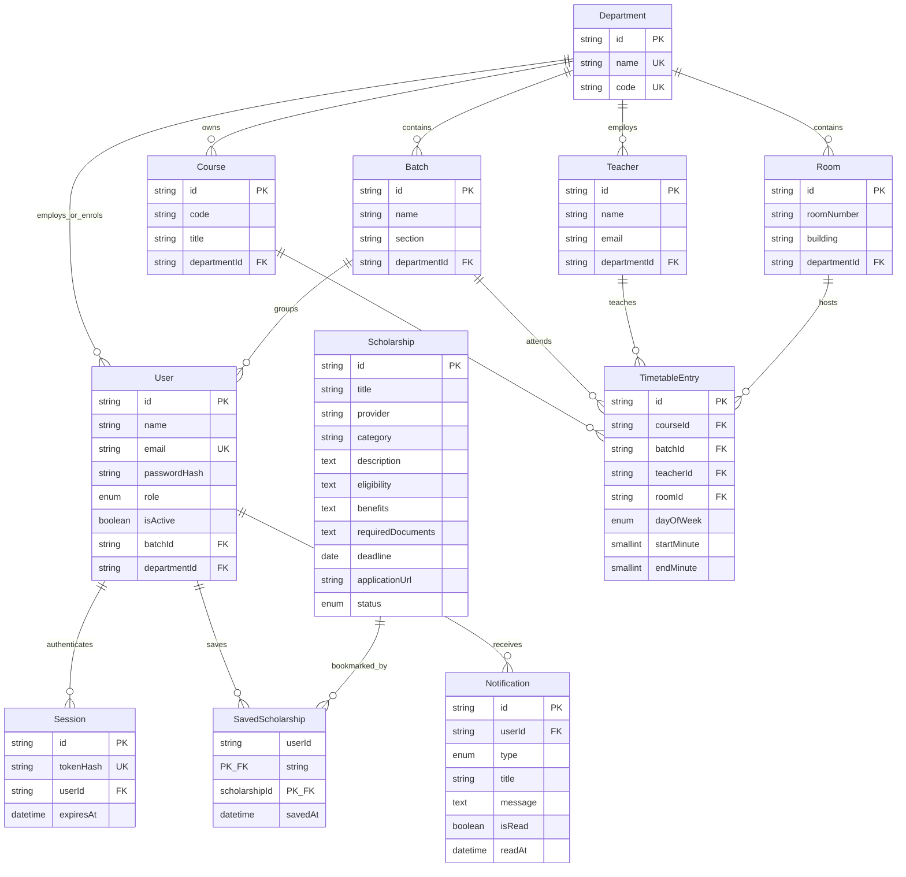
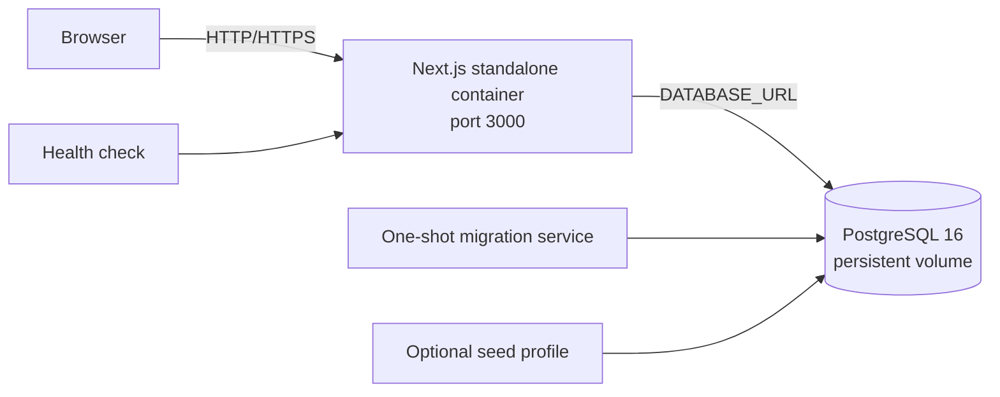

# Final Report — University Scholarship and Academic Timetable Portal

**Document version:** 1.0  
**Date:** 7 November 2026  
**Project type:** Final-year project, full-stack web application  
**Stack:** Next.js 16 (App Router), React 19, TypeScript, Tailwind CSS 4, PostgreSQL, Prisma 7

---

## 1. Executive summary

The University Scholarship and Academic Timetable Portal is a single full-stack web application that gives a university department one place to manage two essential academic services: scholarship opportunities and class timetables.

The portal has three roles:

- **Students** browse and save scholarships, follow deadlines, and view the timetable for their own batch.
- **Authorised staff** maintain scholarship records and timetable reference data, create classes, and use automatic room assignment.
- **Coordinators** manage user accounts and review department-wide activity.

The project deliberately stops at those two modules. It is not a university ERP, a finance system, or an automatic timetable generator. That boundary keeps the business rules small enough to be correct, testable, and explainable.

The final system includes:

- salted bcrypt password hashing and database-backed sessions;
- server-side role checks close to every protected operation;
- a scholarship catalogue with search, filters, bookmarks, and deadline states;
- a timetable with teacher, batch, and room conflict detection;
- deterministic automatic room assignment;
- live role-aware dashboards;
- an in-system notification centre;
- read-only operational reports;
- 73 automated tests (66 unit and 7 database integration);
- a Docker Compose deployment with PostgreSQL, migrations, a health endpoint, and security headers.

---

## 2. Problem and scope

### 2.1 Problem

Scholarship information and timetable information are often published in different places and different formats. Students have to check multiple sources, while staff maintain overlapping spreadsheets and notice boards. The result is duplicated work, missed deadlines, and timetable clashes that are discovered late.

### 2.2 Goal

Provide one authenticated portal where:

1. students can find trustworthy scholarship records and their own schedule;
2. staff can maintain accurate records with validation and conflict checks;
3. coordinators can manage access and review department activity.

### 2.3 Why the scope was intentionally limited

| Tempting feature | Decision | Reason |
| --- | --- | --- |
| Email, SMS, or WhatsApp delivery | Excluded | Requires external providers, credentials, retries, and cost; in-system notifications prove the rule without that operational burden. |
| AI or genetic timetable generation | Excluded | The project is assessed on explainable business logic, not optimisation research. A deterministic room picker is easier to verify. |
| Full university ERP | Excluded | Fees, attendance, payroll, and examinations would dilute the two modules and make the final demonstration shallow. |
| PDF export and scheduled reports | Deferred | Useful later, but not required to demonstrate the data model or the rules. |
| Multi-department tenancy | Partially supported | The schema is department-scoped, but the interface assumes one seeded department for a clear demonstration. |

The limited scope is a design decision, not missing work. Every included feature is complete, validated, and tested.

---

## 3. System architecture

### 3.1 Context diagram



### 3.2 Layers

| Layer | Responsibility | Examples |
| --- | --- | --- |
| Presentation | Server-rendered pages, forms, loading and error states | `app/(portal)/...`, `components/...` |
| Server actions | Authenticate, authorise, validate, mutate, revalidate | `lib/*/actions.ts` |
| Domain rules | Pure, testable business logic | `lib/timetable/rules.ts`, `lib/scholarships/rules.ts` |
| Data access | Centralised Prisma queries | `lib/*/queries.ts`, `lib/db/prisma.ts` |
| Database | Relational integrity and indexes | `prisma/schema.prisma`, migrations |

### 3.3 Request lifecycle

1. A browser requests a protected route.
2. The portal layout calls `requireUser()`.
3. The page calls a role guard such as `requireStaffOrCoordinator()`.
4. The page reads data through a query module, never through ad-hoc SQL in a component.
5. A form submits to a server action.
6. The action validates the payload with Zod, checks the role again, applies the business rule, writes through Prisma, and revalidates affected paths.
7. Redirects and inline messages communicate success or failure.

Authorization is repeated in the server action because a hidden button is not a security control.

---

## 4. Roles and permissions

| Capability | Student | Staff | Coordinator |
| --- | :---: | :---: | :---: |
| Sign in and view own dashboard | Yes | Yes | Yes |
| Browse active scholarships | Yes | Yes | Yes |
| Save or remove a bookmark | Yes | Yes | Yes |
| View own batch timetable | Yes | — | — |
| Read notifications | Yes | Yes | Yes |
| Create or edit scholarships | No | Yes | Yes |
| Publish, expire, archive, or delete scholarships | No | Yes | Yes |
| Create or edit timetable entries | No | Yes | Yes |
| Manage courses, teachers, batches, rooms | No | Yes | Yes |
| View rooms and reports | No | Yes | Yes |
| Create users and change roles | No | No | Yes |
| Activate or deactivate accounts | No | No | Yes |

Navigation is filtered from the same role definitions used by the server guards, so the menu and the protection cannot drift apart silently.

---

## 5. Functional modules

### 5.1 Authentication

- Passwords are hashed with bcrypt.
- A successful login creates a random opaque token.
- Only an HMAC-SHA256 hash of the token is stored in the `Session` table.
- The raw token lives in an HTTP-only, same-site cookie for seven days.
- Deactivated accounts cannot sign in and existing sessions are rejected.
- Signing out deletes the session row and clears the cookie.

### 5.2 Scholarship module

Student view:

- active scholarships only;
- keyword search across title, provider, and description;
- category filter;
- deadline filter;
- saved-only view;
- detail page with eligibility, benefits, required documents, and the official application link.

Staff view:

- create, edit, publish, expire, archive, and delete;
- form validation for lengths, URLs, and real calendar dates;
- last-updated timestamp;
- safe return paths after actions.

Effective status is derived, not rewritten:

```text
stored status = PUBLISHED
AND deadline >= today
=> effective status = ACTIVE

stored status = PUBLISHED
AND today <= deadline <= today + 14 days
=> effective status = CLOSING SOON

stored status = PUBLISHED
AND deadline < today
=> effective status = EXPIRED
```

### 5.3 Timetable module

Staff can maintain:

- courses (unique code per department);
- teachers (optional unique email per department);
- batches with sections;
- rooms with unique room numbers per department;
- timetable entries linking course, batch, teacher, room, day, and time.

Students see only the timetable for their linked batch. Coordinators see the department timetable in read-only form. Every entry stores `startMinute` and `endMinute` as integer minutes from midnight, which makes overlap checks simple and index-friendly.

### 5.4 Conflict detection

Before a timetable entry is saved, the server checks three resource types independently:

1. **Teacher conflict** — the teacher already teaches an overlapping class.
2. **Batch conflict** — the batch already has an overlapping class.
3. **Room conflict** — the room is already occupied.

The interval rule is the standard half-open comparison:

```text
existingStart < newEnd
AND
existingEnd > newStart
```

The end of a class is exclusive. A class ending at 10:00 therefore does not conflict with a class starting at 10:00. When editing, the row being edited is excluded from its own check.

### 5.5 Automatic room assignment

When staff request automatic assignment, the system:

1. reads all rooms in the department in room-number order;
2. removes rooms with an overlapping entry on the selected day;
3. returns the first remaining room;
4. reports clearly when no room is free.

The algorithm is deterministic: the same data and time slot always produce the same room. This is intentional. It is easy to test, easy to explain, and does not pretend to solve a scheduling optimisation problem.

### 5.6 Dashboards

Student dashboard:

- active scholarships;
- deadlines within 14 days;
- saved scholarships;
- today's classes;
- next class, including the correct day and room.

Staff and coordinator dashboard:

- active scholarships;
- expiring scholarships;
- total rooms;
- classes scheduled;
- free rooms today;
- timetable conflicts.

### 5.7 Notifications

Notifications are stored per user and cover scholarship publication, approaching deadlines, expiry, timetable changes, room assignment, and conflicts. Users can mark one notification or all notifications as read. No external delivery channel is used.

### 5.8 Reports

Read-only reports for staff and coordinators:

- active scholarship list;
- scholarships expiring soon;
- timetable by batch;
- timetable by teacher;
- room usage today;
- conflict summary.

Reports reuse the same query and rule modules as the operational pages, so report values cannot disagree with the working screens.

### 5.9 User management

Coordinators can create accounts, assign roles, link students to a batch, link staff to a department, and activate or deactivate accounts. Role changes take effect on the next request because the session lookup reads the current user record.

---

## 6. Data model

### 6.1 ER diagram



### 6.2 Relationship explanations

| Relationship | Cardinality | Meaning |
| --- | --- | --- |
| Department → User | one-to-many, optional | Staff belong to a department; students may also be linked for scope. |
| Batch → User | one-to-many, optional | A student account may be linked to one batch. Staff and coordinators are not batch-bound. |
| User → Session | one-to-many | A user may have several active devices; each session can be revoked independently. |
| User ↔ Scholarship through SavedScholarship | many-to-many | A student can save many scholarships, and a scholarship can be saved by many students. The join table stores `savedAt`. |
| User → Notification | one-to-many | Notifications are private to one account. |
| Department → Course / Teacher / Batch / Room | one-to-many | Reference data is department-scoped, and uniqueness rules include the department. |
| Course / Batch / Teacher / Room → TimetableEntry | one-to-many | A timetable row is the intersection of all four resources at one time. |
| Department → TimetableEntry | indirect | Every entry belongs to a department through its course, batch, teacher, and room. |

Deletion behaviour is deliberate:

- `Session`, `SavedScholarship`, and `Notification` cascade with the user or scholarship.
- `TimetableEntry` uses `Restrict` on reference data, so a course, batch, teacher, or room cannot be deleted while a class still uses it.
- That restriction protects historical schedule integrity and produces a clear error instead of silent data loss.

---

## 7. Authentication and authorization

### 7.1 Authentication

1. The login action normalises the email and validates the form.
2. The user record is loaded by email.
3. Inactive accounts are rejected.
4. bcrypt compares the submitted password with the stored hash.
5. A random 32-byte token is created.
6. The token is hashed with HMAC-SHA256 using `SESSION_SECRET`.
7. The hash is stored in `Session`; the raw token is written to an HTTP-only cookie.
8. Every later request hashes the cookie token and looks up a non-expired session.

If the database leaks, the stored hashes cannot be replayed as cookies because the raw token is not stored.

### 7.2 Authorization

Authorization is enforced in three places:

- the authenticated layout requires a session;
- the page requires a role before loading protected data;
- the server action repeats the role check before mutating data.

The menu is filtered from the same role lists, but the menu is treated as presentation only. A user who types a URL directly is still blocked on the server.

### 7.3 Verified access matrix

The deployed application was tested with three real accounts:

| Route | Student | Staff | Coordinator |
| --- | :---: | :---: | :---: |
| `/scholarships` | Allowed | Allowed | Allowed |
| `/timetable` | Allowed | Allowed | Allowed |
| `/rooms` | Blocked | Allowed | Allowed |
| `/reports` | Blocked | Allowed | Allowed |
| `/users` | Blocked | Blocked | Allowed |

---

## 8. Validation and error handling

Every server input is validated with Zod before use:

- email normalisation and format;
- password policy (12–72 characters, at least one letter and one number);
- role enumeration;
- name and text length limits;
- real calendar dates, including rejection of impossible dates such as 31 February;
- HTTP/HTTPS application URLs only;
- timetable day enumeration;
- `HH:mm` clock parsing, including the exclusive `24:00` boundary;
- start time strictly before end time;
- required reference identifiers;
- same-origin return paths, preventing open redirects.

The interface provides loading skeletons, empty states, and error boundaries. Validation messages appear next to the affected field rather than in a generic banner.

---

## 9. Testing strategy and evidence

### 9.1 Test tooling

Vitest was selected because it runs TypeScript directly with minimal configuration and fits the existing Next.js project. The suite is split into fast unit tests and database-backed integration tests.

```bash
npm test                  # all tests
npm run test:unit         # unit tests only
npm run test:integration  # database-backed tests
npm run check             # lint + typecheck + Prisma validate + tests
```

### 9.2 Results

| Suite | Files | Tests | Result |
| --- | ---: | ---: | --- |
| Unit | 4 | 66 | Passed |
| Integration | 1 | 7 | Passed |
| **Total** | **5** | **73** | **Passed** |

Quality gates on 7 November 2026:

| Gate | Command | Result |
| --- | --- | --- |
| Linting | `npm run lint` | Passed |
| Type checking | `npm run typecheck` | Passed |
| Schema validation | `npm run db:validate` | Passed |
| Tests | `npm test` | 73 passed |
| Production build | `npm run build` | Passed |
| Container health | `GET /api/health` | `{"status":"ok","database":"ok"}` |

### 9.3 What the tests cover

**Timetable rules**

- `HH:mm` parsing and rejection of impossible clock values;
- formatting of times and ranges;
- half-open interval overlap, including touching boundaries;
- teacher, batch, and room conflicts reported separately;
- multiple conflict types for one pair;
- ordering by day, start, and end;
- next-class selection, including a running class and next-week wrap;
- deterministic first-free-room selection;
- no room available.

**Scholarship rules**

- stored status versus effective status;
- active, closing-soon, and expired boundaries;
- inclusive deadline behaviour;
- date formatting and round-tripping.

**Authorization**

- anonymous visitors redirect to login;
- wrong roles redirect to the dashboard with a forbidden marker;
- authentication is checked before role membership;
- role predicates and labels;
- navigation filtering for each role.

**Validation**

- email normalisation and rejection;
- password policy;
- role enumeration;
- user creation and role updates;
- scholarship fields, deadline validity, and URL scheme;
- bookmark and status actions;
- filters falling back safely;
- open-redirect prevention;
- timetable entry fields and clock boundaries;
- notification filters and identifiers.

**Database integration**

The integration suite creates an isolated department and cleans up every row afterwards. It verifies against real PostgreSQL:

- all three conflict types for a real overlapping interval;
- touching intervals are not conflicts;
- another day or unrelated resources are ignored;
- the edited entry is excluded from its own check;
- rooms are returned in room-number order;
- the occupied room can be reused when excluded;
- `null` is returned when every room is occupied.

### 9.4 Bug found and fixed by the tests

`findUpcomingTimetableEntry` previously skipped a class that had already ended that day. When every class for the current day had ended, the dashboard could show no next class even though the same class occurs next week. The rule now wraps an ended class to `daysAhead = 7`, and a unit test locks the behaviour.

### 9.5 Manual verification

- Real password login through headless Edge as a student landed on `/dashboard` and showed the student name and student-only navigation.
- The access matrix above was verified against the running containers using authenticated requests.
- The public page, login page, dashboards, scholarships, timetable, notifications, rooms, reports, and users pages were captured as screenshots.
- All measured mobile pages fitted a 390 px viewport with no horizontal page overflow.
- Database checks found 0 orphaned timetable rows, 0 invalid intervals, 0 teacher/batch/room conflicts in seeded data, and 0 users without a password hash.
- Both Prisma migrations were applied successfully.
- Stopping PostgreSQL made `/api/health` return HTTP 503 with `{"status":"unavailable","database":"error"}`; starting it again restored HTTP 200.

---

## 10. Security

| Control | Implementation |
| --- | --- |
| Password storage | bcrypt with per-password salt |
| Session storage | HMAC-SHA256 hash of an opaque token; raw token never stored |
| Cookie | HTTP-only, same-site, seven-day expiry, secure in production |
| Authorization | Server-side guards on pages and server actions |
| Input validation | Zod schemas on every server input |
| SQL injection | Parameterised Prisma queries |
| Open redirects | Allow-list sanitisation of return paths |
| Clickjacking | `X-Frame-Options: DENY` |
| MIME sniffing | `X-Content-Type-Options: nosniff` |
| Referrer leakage | `strict-origin-when-cross-origin` |
| Browser features | Restrictive `Permissions-Policy` |
| Transport | HSTS header; HTTPS terminated by the reverse proxy |
| Framework disclosure | `X-Powered-By` disabled |
| Container | Non-root runtime user |
| Secrets | Environment variables, never committed |

A Content Security Policy was not added because Next.js injects inline bootstrap scripts and a strict policy would break the application without a nonce infrastructure. This is recorded as a deliberate limitation rather than an oversight.

---

## 11. Deployment and operations

The supported deployment is Docker Compose:



| Service | Purpose |
| --- | --- |
| `db` | PostgreSQL 16 with a persistent volume |
| `migrate` | Applies committed migrations, then exits |
| `app` | Standalone Next.js runtime, non-root, exposes `/api/health` |
| `seed` | Optional demo data, only with the `tools` profile |

Verified deployment state:

- `db` healthy;
- `migrate` exited successfully;
- `app` healthy;
- `/api/health` returned `{"status":"ok","database":"ok"}`;
- security headers present;
- `X-Powered-By` absent;
- demo data seeded: 7 scholarships, 22 timetable rows, 7 notifications.

Full commands, backups, and troubleshooting are in `docs/deployment.md`.

---

## 12. Performance and usability

### 12.1 Response times

Measured against the local Docker deployment, three samples per route, warm server:

| Route | Average |
| --- | ---: |
| Public home | 11.7 ms |
| Login | 46.8 ms |
| Health | 6.2 ms |
| Student dashboard | 87.2 ms |
| Student scholarships | 36.5 ms |
| Student timetable | 28.4 ms |
| Staff reports | 48.2 ms |
| Staff rooms | 28.9 ms |

These are single-user local measurements, not a production benchmark. They are sufficient to show that no page performs unnecessary heavy work at the seeded data size.

### 12.2 Responsive behaviour

All key routes were audited at 390 × 844 and 1440 × 1000:

- no horizontal page overflow at 390 px;
- the portal navigation scrolls horizontally on small screens by design;
- tables scroll inside their cards instead of widening the page;
- report cards use `min-w-0` inside grids so wide tables stay contained;
- forms stack into a single column;
- dashboard cards reflow from three columns to one.

One real issue was found during this audit: the reports page widened to 575 px on a 390 px viewport because grid children defaulted to `min-width: auto`. Adding `min-w-0` to the batch and teacher report cards fixed it.

### 12.3 Usability details

- visible focus styles and a skip link;
- accessible labels and error text on forms;
- empty states for every list;
- loading skeletons for data-heavy routes;
- friendly not-found pages for missing scholarships and classes;
- role badge and scope shown in the header;
- confirmation wording before destructive actions.

---

## 13. Screenshot index

All screenshots are in `docs/reports/screenshots/2026-11-07/`.

| File | Screen |
| --- | --- |
| `01-public-overview.png` | Public overview |
| `02-login.png` | Sign-in page |
| `03-student-dashboard.png` | Student dashboard |
| `04-student-scholarships.png` | Student scholarship catalogue |
| `05-student-timetable.png` | Student timetable |
| `06-student-notifications.png` | Student notifications |
| `07-staff-dashboard.png` | Staff dashboard |
| `08-staff-timetable.png` | Staff timetable management |
| `09-staff-rooms.png` | Room management |
| `10-staff-reports.png` | Staff reports |
| `11-staff-scholarships.png` | Staff scholarship management |
| `12-coordinator-dashboard.png` | Coordinator dashboard |
| `13-coordinator-users.png` | User management |
| `14-coordinator-reports.png` | Coordinator reports |
| `15-public-mobile.png` | Public overview at 390 px |
| `16-login-mobile.png` | Login at 390 px |
| `17-student-dashboard-mobile.png` | Student dashboard at 390 px |
| `18-staff-reports-mobile.png` | Reports at 390 px after the overflow fix |

---

## 14. Use cases

| ID | Actor | Use case | Main flow | Failure handling |
| --- | --- | --- | --- | --- |
| UC-01 | Any user | Sign in | Enter email and password → session created → dashboard | Invalid credentials or inactive account message |
| UC-02 | Student | Browse scholarships | Open catalogue → search/filter → open detail | Empty result state |
| UC-03 | Student | Save scholarship | Press save on card or detail → bookmark stored | Invalid id rejected |
| UC-04 | Student | View own timetable | Open timetable → batch-filtered weekly view | No batch message |
| UC-05 | Student | Read notifications | Open notifications → mark read | Invalid id rejected |
| UC-06 | Staff | Create scholarship | Open form → validate → save as draft | Field-level errors |
| UC-07 | Staff | Publish scholarship | Set published → visible to students | Deadline validation |
| UC-08 | Staff | Create timetable entry | Choose resources and slot → server checks conflicts → save | Conflict list or field errors |
| UC-09 | Staff | Auto-assign room | Request auto assignment → first free room selected | “No room available” message |
| UC-10 | Staff | Maintain reference data | Add/edit/delete course, teacher, batch, room | Delete blocked while in use |
| UC-11 | Staff | View reports | Open reports → live summaries | Empty states |
| UC-12 | Coordinator | Create user | Open people page → choose role → save | Validation and uniqueness errors |
| UC-13 | Coordinator | Change user role | Select new role → save | Cannot demote own last coordinator path if invalid |
| UC-14 | Coordinator | Activate/deactivate account | Toggle status → save | Existing sessions rejected when inactive |
| UC-15 | Any user | Sign out | Press sign out → session deleted → login page | — |

---

## 15. Limitations

1. **Single department in the interface.** The schema is department-scoped, but the demonstration uses one seeded department.
2. **No external notification delivery.** Notifications stay inside the portal.
3. **No holiday calendar or semester model.** The timetable is a weekly repeating schedule.
4. **No drag-and-drop timetable editing.** The table-oriented form is simpler and safer.
5. **No PDF export.** Reports are viewed in the browser.
6. **No CSP.** Inline Next.js scripts would require a nonce pipeline.
7. **No multi-node session cache.** Session lookups use PostgreSQL directly, which is correct but not optimised for very high concurrency.
8. **Automatic assignment is greedy, not optimal.** It selects the first free room deterministically.

---

## 16. Future work

- Add a semester and holiday calendar with effective date ranges.
- Add email or push delivery behind a queue with retries.
- Add CSV/PDF export for reports.
- Add a nonce-based CSP.
- Add end-to-end browser tests for the critical flows.
- Add soft deletion and an audit trail for scholarship changes.
- Add multi-department switching for coordinators.
- Add pagination once the timetable or catalogue grows beyond a few hundred rows.

---

## 17. Conclusion

The portal meets its defined scope: two academic services, three roles, clear business rules, server-side enforcement, automated tests, and a reproducible deployment. The strongest parts of the project are the parts that can be defended line by line: the interval overlap rule, the deterministic room assignment, the derived scholarship state, and the session model.

The project is small on purpose. Every included feature is implemented, verified, documented, and demonstrated.

---

## Appendix A — Route map

| Route | Access | Purpose |
| --- | --- | --- |
| `/` | Public | Product overview |
| `/login` | Public | Sign in |
| `/dashboard` | Authenticated | Role-aware summary |
| `/notifications` | Authenticated | Personal notification centre |
| `/scholarships` | Authenticated | Student catalogue or staff management |
| `/scholarships/new` | Staff, coordinator | Create scholarship |
| `/scholarships/[id]` | Authenticated | Detail, bookmark, staff controls |
| `/scholarships/[id]/edit` | Staff, coordinator | Edit scholarship |
| `/timetable` | Authenticated | Student view or staff management |
| `/timetable/new` | Staff, coordinator | Create class |
| `/timetable/[id]/edit` | Staff, coordinator | Edit class |
| `/timetable/courses` | Staff, coordinator | Course reference data |
| `/timetable/teachers` | Staff, coordinator | Teacher reference data |
| `/timetable/batches` | Staff, coordinator | Batch reference data |
| `/rooms` | Staff, coordinator | Room management |
| `/reports` | Staff, coordinator | Operational reports |
| `/users` | Coordinator | User and role management |
| `/api/health` | Infrastructure | Database-aware health check |

## Appendix B — Short viva answers

- **Overlap rule:** two classes overlap when the existing start is before the new end and the existing end is after the new start.
- **Room assignment:** list department rooms in room-number order, discard rooms with an overlapping entry, take the first remaining room.
- **Session security:** store only an HMAC hash of a random token; the cookie holds the raw token.
- **Authorization:** check the role on the server before reading or mutating, not only in the menu.
- **Scholarship expiry:** derive the effective state from stored status and the calendar deadline instead of rewriting rows on a timer.
- **Why limited scope:** correctness and defensibility beat breadth for a final-year project.
